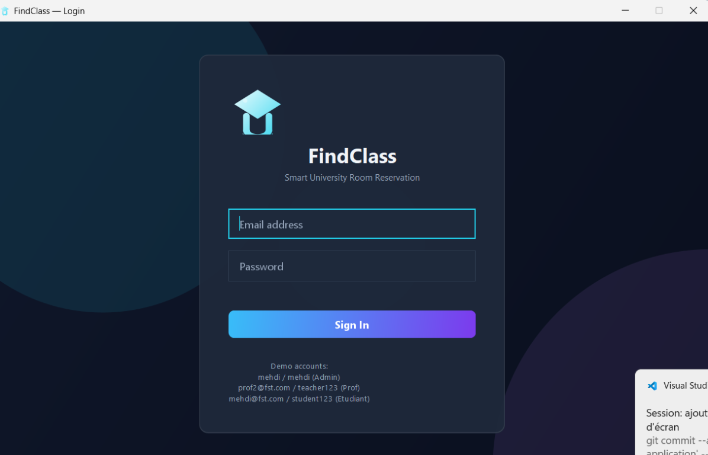
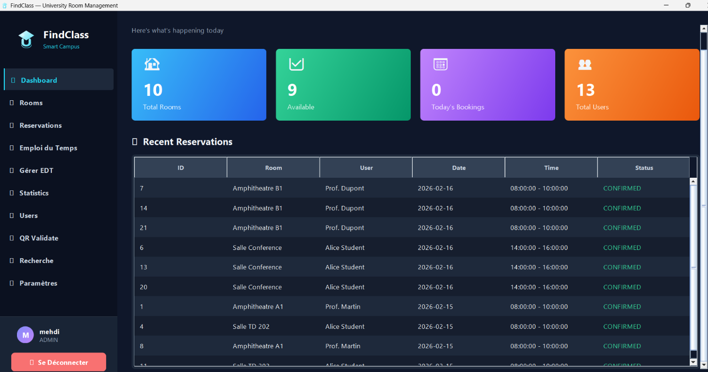
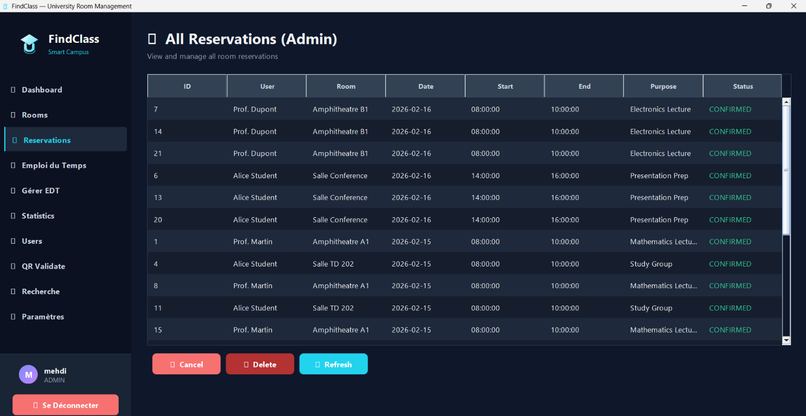
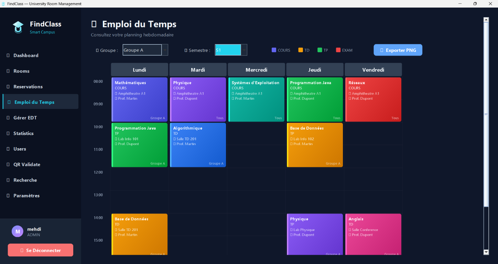

# FindClass

<p align="center">
  
</p>

<h3 align="center">Smart university room reservation and timetable management</h3>

<p align="center">
  
  
  
  
</p>

---

## Apercu

**FindClass** est une application desktop Java permettant aux universites de gerer les salles, les emplois du temps et les reservations. Elle propose trois espaces adaptes aux administrateurs, enseignants et etudiants, avec une interface sombre moderne.

## Fonctionnalites

- Authentification et autorisations par role
- Gestion des salles, equipements, batiments et statuts
- Recherche intelligente de salles et suggestions de creneaux
- Reservations avec prevention des conflits
- Emploi du temps hebdomadaire
- Tableau de bord avec statistiques et graphiques
- Generation et validation de QR codes
- Gestion des utilisateurs et des reservations
- Export des donnees

## Captures d'ecran

| Connexion | Tableau de bord |
|:---:|:---:|
|  |  |

| Reservations | Emploi du temps |
|:---:|:---:|
|  |  |

## Rôles

| Role | Acces |
|---|---|
| Administrateur | Salles, utilisateurs, reservations, emploi du temps et statistiques |
| Enseignant | Emploi du temps, reservations et validation |
| Etudiant | Recherche de salles, reservations personnelles et emploi du temps |

## Comptes de demonstration

| Email / identifiant | Mot de passe | Role |
|---|---|---|
| `mehdi` | `mehdi` | Administrateur |
| `prof2@fst.com` | `teacher123` | Enseignant |
| `mehdi@fst.com` | `student123` | Etudiant |

> Ces comptes sont fournis pour une base locale de demonstration. Ils ne doivent pas etre utilises en production.

## Stack technique

- Java 17
- Java Swing
- JDBC
- MySQL
- ZXing pour les QR codes
- Pattern DAO
- Architecture MVC

## Installation

### 1. Prerequis

- JDK 17 ou superieur
- MySQL 8 ou superieur

### 2. Initialiser la base

```bash
mysql -u root -p < sql/schema.sql
```

### 3. Configurer la connexion

La configuration peut etre fournie via des variables d'environnement. Les valeurs locales par defaut sont MySQL sur `localhost:3306`.

**Windows PowerShell**

```powershell
$env:UNIROOM_DB_URL = "jdbc:mysql://localhost:3306/uniroom?useSSL=false&serverTimezone=UTC&allowPublicKeyRetrieval=true"
$env:UNIROOM_DB_USER = "root"
$env:UNIROOM_DB_PASSWORD = "VotreMotDePasse"
```

**Linux/macOS**

```bash
export UNIROOM_DB_URL="jdbc:mysql://localhost:3306/uniroom?useSSL=false&serverTimezone=UTC&allowPublicKeyRetrieval=true"
export UNIROOM_DB_USER="root"
export UNIROOM_DB_PASSWORD="VotreMotDePasse"
```

### 4. Compiler et lancer

Sous Windows :

```bat
build.bat
cd dist
FindClass.bat
```

Avec Java directement :

```bash
javac -cp "src/lib/mysql-connector-j-9.5.0.jar" -d bin -encoding UTF-8 $(find src -name "*.java")
java -cp "bin:src/lib/mysql-connector-j-9.5.0.jar" Main
```

## Structure du projet

```text
FindClass/
├── src/
│   ├── Main.java
│   ├── dao/
│   ├── gui/
│   │   └── components/
│   ├── model/
│   ├── util/
│   └── lib/
├── sql/
├── docs/screenshots/
├── build.bat
└── README.md
```

## Auteur

Projet realise par **Mahdi Braiek**.

## Licence

Ce projet est fourni a des fins educatives.
